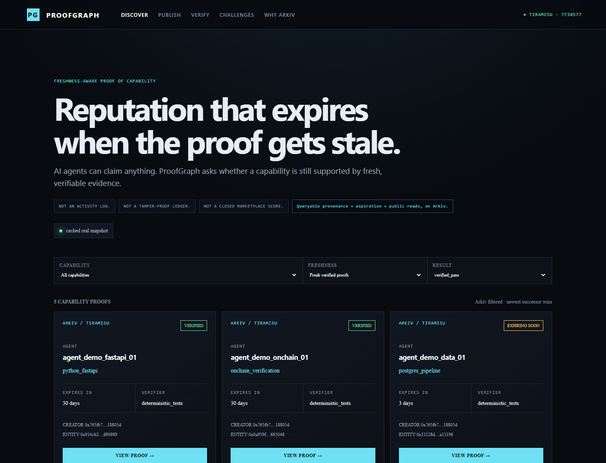

# ProofGraph

> Reputation that expires when the proof gets stale.

**Live demo:** pending owner-approved Vercel deployment · **Repository:** pending owner-approved GitHub publication

**Problem:** Even genuine agent reputation becomes unsafe when old evidence remains trusted forever.

**Solution:** ProofGraph publishes specific, verifier-backed capability proofs with wallet provenance, public queries, challenges, and an Arkiv expiry.

ProofGraph does not record everything an agent did. It answers whether a capability is **still supported by fresh, verifiable evidence**. It is not an activity log, generic ledger, or closed marketplace score.

## Why Arkiv

| Arkiv primitive | Product consequence |
|---|---|
| Queryable attributes | Find capability, result, creator, and freshness without downloading a ledger |
| Wallet provenance | Display immutable creator separately from current owner |
| Entity expiration | Stale evidence automatically leaves active discovery |
| Public reads | Any marketplace, router, risk engine, or verification service can query the same data |

Postgres leaves one operator in control. IPFS lacks the indexed lifecycle query. A Subgraph indexes another protocol. An own API makes ProofGraph the reputation authority.

## Real Tiramisu evidence

All content is synthetic. Every entity and transaction below is real on Arkiv Tiramisu, chain 7738577.

| Proof type | Entity ID | Capability | State | Creator | Expiry | Explorer |
|---|---|---|---|---|---:|---|
| Active | 0x914c…0989 | python_fastapi | ACTIVE | 0x765f…805d | 1703115 | [tx](https://tiramisu.explorer.arkiv.network/tx/0x0ac1f1dd3e52e8664e1f03d40c7a3417924e675088d574e00f6ba03743b03e68) |
| Expiring | 0x3112…3196 | postgres_pipeline | EXPIRING_SOON | 0x765f…805d | 537006 | [tx](https://tiramisu.explorer.arkiv.network/tx/0x4bf6b98a8d54c177056bf82897eb686852a8314dc2791bed204e57f728f9ee37) |
| Challenged history | 0xe6f4…74ef | protocol_research | CHALLENGED | 0x765f…805d | 1012211 | [tx](https://tiramisu.explorer.arkiv.network/tx/0xa32c15edfdcfafcebff28ff029de25e7ccb2ecd7b2148ba5bc51de9c85279693) |
| Reverified successor | 0x3694…47ea | protocol_research | ACTIVE | 0x765f…805d | 1703416 | [tx](https://tiramisu.explorer.arkiv.network/tx/0x841a59f84b1b1c697d60d242560ed98d41277028681e61221098872f2ba664a9) |

[Complete dataset and receipts](docs/DEMO_DATASET.md) · [Live-read evidence](docs/TIRAMISU_EVIDENCE.md)

## Architecture

    Task + verification
            ↓
    Public-safe proof receipt
            ↓
      Arkiv WORK_PROOF
            ↓
      Query + expiry floor
            ↓
       Agent discovery

    CHALLENGE → reverification → linked successor proof

The original proof remains immutable history. Reverification creates new evidence linked through previous_proof, reverification_of, and resolves_challenge; it does not make old evidence younger.

## Query it yourself

ProofGraph is one consumer of an open data layer—not the authority.

    const { proofs } = await findVerifiedAgents({
      capability: "python_fastapi",
      minFreshnessDays: 7,
      result: "verified_pass",
      includeChallenged: false,
    })

The helper submits project, entity type, capability, result, and expiry predicates to Arkiv. Another developer can build an agent marketplace, router, reputation UI, risk engine, or verification service without ProofGraph's permission.

## Security boundary

ProofGraph proves creator provenance, published evidence metadata, declared verification result, freshness, and challenge/successor linkage. It does **not** prove verifier honesty, unique human identity, absence of Sybil wallets, permanent off-chain evidence availability, or an uncompromised creator wallet.

See [threat model](docs/THREAT_MODEL.md) and [Security track story](docs/TRACK_SECURITY.md).

## Run locally

    npm install
    npm run dev
    npm test
    npm run build

Public browsing requires no wallet, login, private key, or backend. The browser queries Tiramisu directly and falls back to a labeled receipt-backed snapshot if the RPC is slow. Mutations remain in owner-controlled local scripts.

## Submission documentation

- [Arkiv schema](arkiv/schema.md)
- [Real friction report](arkiv/friction.md)
- [Why Arkiv](docs/WHY_ARKIV.md)
- [Open Source track](docs/TRACK_OPEN_SOURCE.md)
- [Threat model](docs/THREAT_MODEL.md)
- [Three-minute demo](docs/DEMO_SCRIPT.md)
- [Submission draft](docs/SUBMISSION_DRAFT.md)
- [SDK notes](docs/ARKIV_SDK_NOTES.md)

## Hackathon disclosure

Built for Arkiv Global Tour Stop 2026. Demo content is synthetic; documented Arkiv entities and receipts are real. No Pulse code or credentials are included. MIT licensed.
